# ARCHITECT.md — Architecture & Technical Specifications

Technical architecture and component design specifications for the **Học 30 phút — Landing Page** repository.

---

## 1. Architectural Principles & Design Philosophy

The landing page is engineered around **Option 3: Story-Driven Dungeon Quest Scroll**, fusing classic 16-bit RPG aesthetics with modern Conversion Rate Optimization (CRO) and Product-Led Growth (PLG) frameworks observed in leading gamified EdTech and productivity applications (Duolingo, Habitica, Codédex, Forest App):

1. **Product-Led Growth (Play-First Experience)**: Instead of passive text descriptions, visitors interact with core product mechanisms immediately (tap-to-translate vocabulary, answer reflex quiz questions, open treasure chests, and simulate plant revival) before signing up.
2. **Zero Bloat & High Performance**: A client-side Single-Page Application (SPA) without heavyweight router overhead, utilizing modular CSS, local `@fontsource` font packaging, and achieving an ultra-compact production bundle (< 145 KB JS, ~49 KB gzip; < 26 KB CSS, ~5.7 KB gzip).
3. **Strict Retro Quest UI Kit v2 Integrity**: Uncompromising commitment to 16-bit pixel fidelity—rejecting modern blur gradients and rounded corners in favor of sharp, high-contrast, integer-scaled pixel art and authentic retro typography.

---

## 2. Component Hierarchy & Data Flow

```mermaid
graph TD
    App["App.vue (Global Canvas)"]
    
    subgraph GLOBAL["Global Services & Overlays"]
        Toast["RetroToast.vue"]
        Navbar["HudNavbar.vue"]
    end
    
    subgraph STORY["Story Scroll Sections (Option 3 Narrative)"]
        Hero["HeroShrine.vue (Prologue: Starting Shrine)"]
        Conn1["ChapterConnector.vue (Gate I)"]
        Ch1["ChapterOneSeed.vue (Chapter I: The Seed)"]
        Conn2["ChapterConnector.vue (Gate II)"]
        Ch2["ChapterTwoQuestRoom.vue (Chapter II: 30-Min Room)"]
        Conn3["ChapterConnector.vue (Gate III)"]
        Ch3["ChapterThreeCompanion.vue (Chapter III: The Companion)"]
        Conn4["ChapterConnector.vue (Gate IV)"]
        Ch4["ChapterFourWorldMap.vue (Chapter IV: World Map)"]
        Conn5["ChapterConnector.vue (Gate V: The Inn)"]
        Inn["TheInnFaq.vue (The Inn: Open Beta & FAQ)"]
        Footer["FinalBossFooter.vue (Departure Gate & Sticky CTA)"]
    end
    
    subgraph ATOMIC["Atomic Component Kit"]
        Panel["RetroPanel.vue"]
        Button["RetroButton.vue"]
        Pixel["PixelArt.vue"]
        Sprite["CompanionSprite.vue"]
        Speech["SpeechBox.vue"]
        Hp["HpBar.vue"]
        Day["DayBar.vue"]
        Chest["Chest.vue"]
        Node["QuestNode.vue / MapNode.vue"]
        Badge["Badge.vue"]
    end
    
    App --> Navbar
    App --> Toast
    App --> Hero
    App --> Conn1 --> Ch1
    App --> Conn2 --> Ch2
    App --> Conn3 --> Ch3
    App --> Conn4 --> Ch4
    App --> Conn5 --> Inn
    App --> Footer

    Hero --> Panel & Sprite & Speech & Button & Badge & Hp & Pixel
    Ch1 --> Pixel & Panel
    Ch2 --> Panel & Day & QuestNode & Chest & Button & Pixel
    Ch3 --> Panel & Sprite & Speech & Button & Hp & Badge
    Ch4 --> Panel & MapNode & Sprite & Pixel
    Inn --> Panel & Button & Pixel
    Footer --> Panel & Sprite & Chest & Button & Pixel
```

---

## 3. Design Token System (Retro Quest UI Kit v2)

All visual variables are centrally registered in [`tailwind.config.ts`](file:///home/huyndg-pc/workspaces/English-learning-landing-page/tailwind.config.ts) and mapped to semantic CSS tokens:

### 3.1 Dungeon Torch Palette
* **Grounds (Backgrounds)**:
  * `ground-0` (`#0f0e17`): Deep dungeon void (canvas background).
  * `ground-1` (`#1a1829`): Primary elevated surface / chamber card background.
  * `ground-2` (`#26233d`): Secondary active surface / selected state background.
* **Accents & Illumination**:
  * `torch` (`#f4b41b`): Radiant golden torch (primary highlights, rewards, key titles).
  * `torch-deep` (`#b87d14`): Torch shadow / bevel depth.
  * `growth` (`#3ddc97`): Vibrant sprout green (progress, successful actions, full health).
  * `growth-deep` (`#1b7a4f`): Sprout shadow / bevel depth.
  * `ember` (`#ff6b6b`): Dying ember red (health loss warnings, wilted states, old habits).
  * `ember-deep` (`#a63a3a`): Ember shadow / warning depth.
* **Borders & Dividers**:
  * `line-lit` (`#5c5799`): Active illuminated border.
  * `line-dim` (`#2d2a4a`): Subtle structural separator.
* **Typography Inks**:
  * `ink-0` (`#f4f1de`): Crisp ivory white (primary headings and key dialogue).
  * `ink-1` (`#c5c2d6`): Soft gray-violet (body prose and passage reading text).
  * `ink-2` (`#8b87a5`): Muted ink (secondary metadata and footnotes).

### 3.2 Typography Hierarchy
* **Display Font (`font-display`)**: `VT323, monospace` — 8-bit arcade typeface powering headlines, button labels, quest badges, and HUD indicators.
* **Body Font (`font-body`)**: `Nunito, sans-serif` — Rounded, highly legible font providing complete Vietnamese diacritic support for reading exercises and FAQ explanations.

---

## 4. Pure SVG Pixel-Art Engine (`PixelArt.vue`)

All graphics and glyphs are generated programmatically without raster image dependencies:

1. **Matrix Definitions (`pixelArt.ts`)**: Each sprite is modeled as an array of $N \times N$ string rows (16×16 or 32×32 grids). Characters correspond directly to `PALETTE` color roles (`k`, `t`, `g`, `e`, `i`, `l`, `d`), while `.` denotes transparent coordinates.
2. **Integer Grid Snapping Formula**:
   $$\text{snappedSize} = \max\left(n, \left\lfloor\frac{\text{size}}{n}\right\rfloor \times n\right)$$
   Guarantees that rendered output always scales to whole-number multiples ($1\times, 2\times, 3\times$), preventing blurriness, sub-pixel distortion, or jagged anti-aliasing.
3. **Horizontal Run-Length Rect Batching**:
   Rather than generating individual $1\times 1$ `<rect>` elements, the engine aggregates contiguous horizontal pixels of identical color into a single `<rect width="W">`, cutting SVG DOM node counts by up to 70%.

---

## 5. Composables & State Architecture

### 5.1 `useActiveSection.ts` (Scroll Spy & Descent Depth Gauge)
* Leverages `IntersectionObserver` with thresholds `[0.15, 0.5]` to determine which chapter currently commands user attention.
* Attaches a passive window scroll listener to calculate depth percentage ($0\% \to 100\%$):
  $$\text{depthPercent} = \min\left(100, \max\left(0, \frac{\text{scrollY}}{\text{scrollHeight} - \text{innerHeight}} \times 100\right)\right)$$
* Synchronizes the real-time active link highlight and the 4px bottom gauge in `HudNavbar.vue`.

### 5.2 `useReducedMotion.ts` (Accessibility Guard)
* Monitors the system-level `prefers-reduced-motion: reduce` media query.
* Bypasses ambient pulsing and screen-shake animations, ensuring dialogue bubbles in `SpeechBox.vue` reveal all text instantly without delayed character typing.

### 5.3 `useRetroToast.ts` (Single-Channel Notification Queue)
* Manages a non-intrusive, single-slot notification toast. Triggering a new toast immediately cancels any pending dismissal timer (3200ms) and smoothly transitions content.

---

## 6. Virtual Plant Lifecycle Engine (`plant.ts`)

Accurately mirrors the backend companion decay and progression algorithm:
* **Stages**: `seed` $\to$ `sprout` $\to$ `sapling` $\to$ `flowering` $\to$ `fruitful` $\to$ `wilted`.
* **State Determination Logic**:
  $$\text{Stage} = \begin{cases} 
  \text{wilted} & \text{if } \text{hp} \le 0 \\
  \text{fruitful} & \text{if } \text{streak} \ge 14 \\
  \text{flowering} & \text{if } \text{streak} \ge 7 \\
  \text{sapling} & \text{if } \text{streak} \ge 3 \\
  \text{sprout} & \text{if } \text{streak} \ge 0 
  \end{cases}$$
* **Daily Delta Formulas**:
  * 30-Minute Study Session Completed: $\text{HP} \leftarrow \min(100, \text{HP} + 20)$, $\text{Streak} \leftarrow \text{Streak} + 1$.
  * Missed Day: $\text{HP} \leftarrow \max(0, \text{HP} - 30)$, $\text{Streak} \leftarrow 0$.
  * Revive Challenge Completed: $\text{HP} \leftarrow 50$, $\text{Streak} \leftarrow 0$.

---

## 7. Testing Strategy & Quality Gates

Every pull request or code change must clear three non-negotiable verification gates:
1. **Linter & TypeCheck**: `oxlint src tests` and `vue-tsc --noEmit` must report **0 warnings and 0 errors**.
2. **Unit Tests (`vitest`)**:
   * UI Kit Compliance Scanner (`retroKitCompliance.test.ts`): Inspects all `.vue` templates to strictly ban `rounded-md+`, `backdrop-blur`, `bg-gradient-*`, `scale-*`, `ease-*`, and `dark:`.
   * Chapter II Interaction Test (`ChapterTwoQuestRoom.test.ts`): Verifies tap-to-translate vocabulary popups, correct option selection, and loot chest opening.
   * Chapter III Sandbox Test (`ChapterThreeCompanion.test.ts`): Verifies HP calculations, wilt/revive mechanics, and gallery stage switching.
   * Chapter IV World Map Test (`ChapterFourWorldMap.test.ts`): Verifies node selection for Days 1–5, locked state enforcement for Days 6–7, and Google Calendar/Tasks status synchronization.
3. **Production Build**: `vite build` must compile cleanly into `dist/`.
